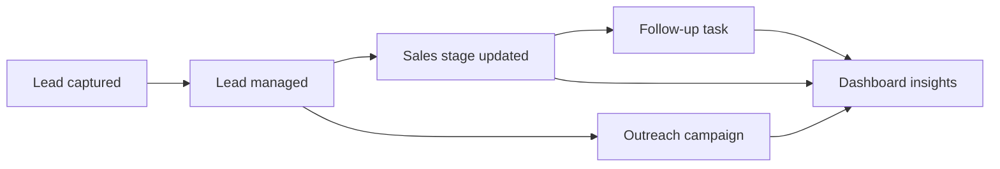

# UPSCALE OS — From Spark to Shipping

> **Product discovery & brainstorming journal**  
> **Project:** UPSCALE OS — B2B Sales Intelligence Platform  
> **Creator:** Aibek Mekhlisov  
> **Inspiration:** Upscale System LLC, discovered through [TrustMRR](https://trustmrr.com/)  
> **Project:** [GitHub repository](https://github.com/Aiboni/upscale-os) · [Live app](https://upscale-os-production.up.railway.app)

---

## 01 / THE SPARK — What if sales felt less chaotic?

**Starting challenge.** Build a non-trivial, full-stack application worth demonstrating, rather than a basic habit tracker or to-do list. The concept should be different from Part I and show real product thinking, persistence, API design, testing, and deployment.

I chose **Upscale System LLC** as the starting business inspiration from TrustMRR. Instead of cloning a company's marketing website, I wanted to transform the underlying B2B sales workflow into a standalone **software product**.

**Core question:** *What if a small sales team could track its prospects, outreach, deals, and next actions in one beautiful workspace?*

## 02 / PROBLEM — Too many disconnected steps

Imagine a small agency or B2B startup managing outreach through a spreadsheet, inbox, notes, and messaging apps. The team can lose context: who replied, who needs a follow-up, which campaigns perform well, and where potential revenue sits.

| Friction | User consequence | Product opportunity |
|---|---|---|
| Prospect details are scattered | Duplicate work, forgotten conversations | Central leads database |
| Campaigns aren't easy to compare | Hard to prioritize outreach | Campaign overview and reply metrics |
| Deal stages are invisible | Uncertain sales forecast | Sales pipeline board |
| Follow-ups are missed | Opportunities go cold | Tasks with completion state |
| Numbers require manual calculations | Slow decision making | Dashboard and analytics |

**Target users:** founders, small agencies, early-stage B2B sales teams, and business development managers.

## 03 / IDEA EXPLORATION — Three directions

| Direction | Why it appealed | Why we did / didn't choose it |
|---|---|---|
| **A. Agency landing page** | Fast, elegant, easy to launch | Too shallow for a non-trivial full-stack assignment |
| **B. Outreach automation service** | Strong link to the source business | Real email/LinkedIn sending introduces external integrations and compliance concerns |
| **C. Sales intelligence workspace** ⭐ | Meaningful data models, workflow, analytics, and interactions | **Selected**: useful as a stand-alone MVP with future integration paths |

### Decision

**UPSCALE OS** became a B2B sales intelligence and CRM workspace inspired by the business category, not a reproduction of the original company website. The first release prioritizes a **functional demo** over claiming unsupported automations.

## 04 / THE VISION — One workspace, clearer growth

**One-line pitch:** *UPSCALE OS organizes leads, campaigns, deals, follow-ups, and sales insights into one visually polished command center.*

**North star:** Help a user understand **what is happening, what matters, and what to do next** within a few seconds.

**Design principles**

1. **Clarity first:** important numbers visible immediately.
2. **Actionable screens:** pages support real create/edit/update flows, not decorative cards.
3. **Premium, calm UI:** restrained violet accents, a dark sidebar, readable light surfaces.
4. **Honest data:** mark illustrative trends as demo data; never present them as connected revenue.
5. **Persistent by default:** database-backed workflows rather than browser-only state.
6. **Expandable architecture:** API contracts, ORM, and clear boundaries for later features.

## 05 / FEATURE STORM — Turn problems into actions

| Feature | User story | MVP outcome |
|---|---|---|
| **Overview** | As a founder, I want to understand my sales activity at a glance. | Metrics, recent activity, pipeline distribution |
| **Leads & Contacts** | As a sales rep, I want to store and find prospects. | CRUD, search, filters, email uniqueness |
| **Campaigns** | As a manager, I want to track outreach initiatives. | Campaign CRUD, status and manually recorded performance |
| **Sales Pipeline** | As a sales rep, I want to move opportunities through stages. | Interactive stage updates |
| **Tasks** | As a team member, I want to track follow-ups. | Task CRUD and completion |
| **Analytics** | As a founder, I want to explore sales indicators. | Aggregated metrics, source breakdown, CSV export |
| **Language switcher** | As a multilingual user, I want an interface in my preferred language. | EN / RU / KZ switcher (added later) |

### Explicit MVP boundaries

- **Included:** functional CRM workflows, SQLite persistence, campaign tracking, pipeline updates, responsive interface, basic analytics, tests, and deployment.
- **Not included as a live integration:** automatic email/LinkedIn sends, Stripe revenue, third-party CRM synchronization, and multi-user authentication.
- **Future work:** login and permissions, real provider integrations, auditable activity logs, deeper analytics, and stronger multilingual coverage.

## 06 / USER JOURNEY — From first lead to next action

**Scenario:** Aibek receives a potential B2B lead.

1. Open **Overview** to see existing pipeline and workload.
2. Select **Add new lead** and enter the contact information.
3. Find the contact in **Leads & Contacts** and update the sales status.
4. Inspect the contact on the **Sales Pipeline** board.
5. Create a **Task** to follow up.
6. Review **Analytics** to see how activity affects summary metrics.
7. Reload and redeploy the app to verify the records survive.

**Success signal:** the contact is not just drawn on screen; it is stored in SQLite and retrieved through the backend API.

## 07 / TECHNICAL DECISIONS — How to make it real

| Layer | Choice | Reason |
|---|---|---|
| Frontend | HTML, CSS, JavaScript | Fast, fine-grained UI control with no heavyweight client setup |
| Backend | FastAPI (Python) | Typed request models and accessible API documentation |
| Persistence | SQLite | Lightweight relational storage for the assignment |
| Data access | SQLAlchemy ORM | DBMS-agnostic modeling instead of raw SQL everywhere |
| API contract | OpenAPI (`openapi.yml`) | Make interfaces clear and testable |
| Tests | pytest + FastAPI TestClient | Repeatable backend verification |
| Version control | GitHub | Source history and issue-based workflow |
| Hosting | Railway + persistent Volume | Public HTTPS app and durable SQLite storage |

**Development sequence considered:** frontend with mock service → OpenAPI contract → in-memory backend → SQLite + ORM backend → connected full stack → tests → public deployment.

## 08 / ITERATION LOG — What changed through feedback

This section is a **curated summary of our actual project discussion and hands-on iterations**, not a verbatim or time-stamped chat transcript.

| Iteration | Observation / feedback | Decision or action |
|---|---|---|
| Ideation | Assignment rejected trivial app concepts. | Choose a sales operations platform inspired by Upscale System LLC. |
| Visual direction | A basic marketing page would not show enough complexity. | Build a premium CRM dashboard with multiple usable sections. |
| First local run | The app started with Uvicorn and opened in the browser. | Verify local UI and backend connectivity. |
| Personalization | Demo displayed a placeholder name. | Change greeting to **Aibek** and initials to **AM**. |
| Version control | Project files were inside a nested `upscale-os/` directory. | Push code to GitHub and configure Railway Root Directory. |
| Public launch | Initial build failed because the project root was incorrect. | Set Railway Root Directory to `/upscale-os`; deploy successfully. |
| Persistent data | SQLite inside an ephemeral container might be lost. | Attach Railway Volume at `/data`; set `DATABASE_URL=sqlite:////data/upscale.db`. |
| Persistence test | A created lead remained after redeployment. | Confirm persistence behavior for the tested record. |
| Automated test | Windows could not delete a still-open temporary SQLite file. | Adjust test temporary-directory handling; rerun pytest successfully. |
| Manual QA | The **Last 7 months** selector did nothing. | Add a real selector and chart update code; production retest still required. |
| Accessibility / localization | Multilingual support would improve the demo. | Add an EN / RU / KZ switcher; verify dynamic strings and UI manually. |

## 09 / QUALITY GATES — What does “done” mean?

**Functional:** each core create/edit/delete action works; statuses and summary counts update correctly.  
**Persistence:** saved records remain after reload and redeploy.  
**Reliability:** automated tests pass and the production health endpoint responds.  
**UI:** common screen widths remain usable; interactive elements behave as labeled.  
**Honesty:** demo-only revenue and outreach values remain clearly labeled.  
**Process:** GitHub Issues carry `mvp`, `post-mvp`, or `user-test-bug`, with verified work closed only after checking acceptance criteria.

### QA backlog and known follow-up

- [ ] Manually verify all dashboard period-selector options on the **published** site.
- [ ] Audit all EN / RU / KZ translations, including dynamically rendered content.
- [ ] Retest responsive layouts on narrow screens.
- [ ] Test negative paths and browser console errors.
- [ ] Close `mvp` and `user-test-bug` Issues only when evidence supports closure.

## 10 / THE TAKEAWAY

> **The creative leap was not copying an existing company. It was turning a sales-services problem into a cohesive, usable software product.**

UPSCALE OS demonstrates product discovery, prioritization, interface design, data modeling, API architecture, persistence, testing, and shipping a real public application. The aim is to make a project that is credible to explain in a live defense — not merely attractive in screenshots.

---

### Provenance note

This journal was written from the real project choices and development milestones discussed in our ChatGPT conversation. It is a polished **brainstorming summary**, **not an exact export of the original chat messages**. For strict compliance with the instructor's request to include *chat history*, add a separate verbatim export of the brainstorming conversation (for example, `_docs/brainstorming-chat-history.md`) without inventing messages or dates.

**Author:** Aibek Mekhlisov  
**Project:** UPSCALE OS  
**Repository:** https://github.com/Aiboni/upscale-os
